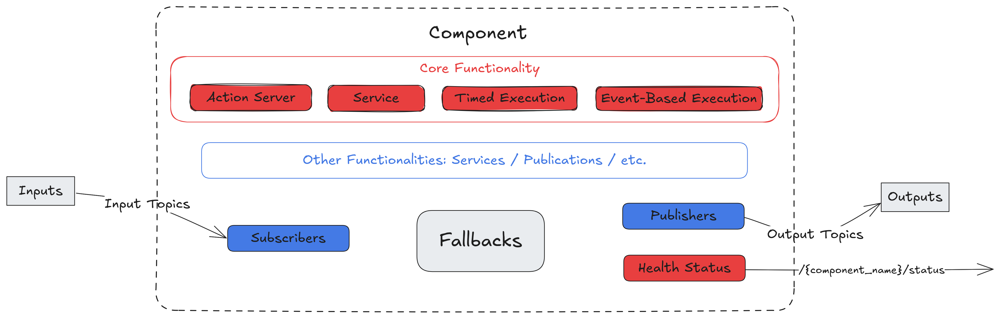

<div align="center">

<picture>
  <source media="(prefers-color-scheme: dark)" srcset="docs/_static/SUGARCOAT_DARK.png">
  <source media="(prefers-color-scheme: light)" srcset="docs/_static/SUGARCOAT_LIGHT.png">
  
</picture>

<br/>

**ROS 2, with the sugar on top**

[](LICENSE)
[](https://emos.automatikarobotics.com/getting-started/installation.html)
[](https://discord.gg/B9ZU6qjzND)

[**Documentation**](https://emos.automatikarobotics.com) · [**Developer Docs**](https://sugarcoat.automatikarobotics.com) · [**API Reference**](https://sugarcoat.automatikarobotics.com/apidocs/index.html) · [**Discord**](https://discord.gg/B9ZU6qjzND)

</div>

---

**Sugarcoat** is the foundation of [EMOS](https://github.com/automatika-robotics/emos), the Embodied Operating System. A ROS 2 application tends to end up as a pile of nodes, launch files and glue, with what the robot actually does scattered across all of them. Sugarcoat gives the robot a nervous system instead. A modern robot drives, watches, listens, speaks and grasps at the same time, in a world that rarely goes to plan, and what it does next has to come from all of it, the moment it happens. A recipe is one Python script in which you declare the components, say which events matter and what happens when they fire, and hand the lot to a launcher that brings the system up, keeps it healthy and takes it down again.

## Building Blocks

| Block | What it gives you |
| :--- | :--- |
| **Component** | A ROS 2 lifecycle node with the plumbing done: declared inputs and outputs, a typed configuration that also loads from YAML, JSON or TOML, a health status, fallbacks, and actions callable by name. Driven by a timer, a trigger topic, a service or an action server. |
| **Topic** | A named, typed stream. Conversion between ROS messages and Python objects is done for you, spatial inputs arrive in the frame the algorithm needs, and `use_plugin` serves a topic from the robot's plugin instead of ROS. |
| **Event** | A condition on live data in plain Python, `Event(battery.msg.data < 20.0)`. Conditions combine across topics with and, or and not, fire on change, once or debounced, and any function returning `bool` can be polled as one. |
| **Action** | Anything callable with its arguments, ready to run when an event fires: a component method, a system action such as restart, reconfigure, publish or log, a plain function, or a plugin action. Arguments can come from topics at run time. A monitored action waits for a success condition, times out, retries and can be cancelled. |
| **Routine** | A named sequence of monitored steps with a retry and failure policy per step. It can be paused, resumed and aborted, publishes its progress, and is started by an event, from the web UI, or by an agent as a tool. |
| **Fallbacks** | Recovery a component runs on its own when its health status turns bad. An algorithm failure, a component failure and a system failure each get their own answer, from a retry to a restart. |
| **Launcher** | Turns the recipe into a running system: configures and activates components as threads or as processes, starts the drivers and external nodes the recipe needs, runs the Monitor that evaluates events and dispatches actions, and supervises until the recipe ends. No launch files. |
| **Robot plugin** | Adapts one robot or sensor to the interfaces recipes use: transports over ROS, UDP, HTTP or a vendor SDK, feedback decoders and command encoders, the robot's own actions and events, drivers to start, sensor mounts published to TF, and how the robot maps. |
| **Web UI and API** | One call serves the recipe's inputs, outputs, settings, actions and routines to a browser, and the same over a JSON and WebSocket API guarded by HTTPS and API keys. |

<div align="center">
<picture>
<source media="(prefers-color-scheme: dark)" srcset="docs/_static/images/diagrams/component_dark.png">
<source media="(prefers-color-scheme: light)" srcset="docs/_static/images/diagrams/component_light.png">

</picture>
</div>

## Key Features

- **Recipes, not launch files.** A whole system is one Python file. It names the components, attaches the robot's plugin, and says which events matter and what should happen when they fire. The launcher does the rest. It configures and activates every component, as threads of one process or as processes of their own, keeps an eye on them while the recipe runs, and shuts the lot down cleanly when it is told to.
- **Events in plain Python.** `Event(battery.msg.data < 20.0)` is a complete event. Field paths are checked against the message type when the recipe is imported, so a typo fails on your desk rather than on the robot. A condition can span several topics, fire only when something changes or only once, and a topic can be given a timeout so that an event never fires on a reading that stopped arriving a minute ago.
- **Actions that know whether they worked.** Give an action a success condition, a timeout, a retry budget and a cancel method, and the Monitor that every launcher runs will dispatch it, wait for the verdict and try again if it has to. Nothing in a component's loop blocks for any of this.
- **Routines for behaviours that take steps.** Detect, approach, grasp, lift. A routine says a sequence like that in one place, with a policy for each step, and can be paused, resumed and aborted from an event, from the web UI, or by an agent that plans with it as a tool. Its progress is published while it runs.
- **Components that heal.** A component reports how it is doing rather than merely that it is alive, and when its status turns bad it runs the fallbacks it was given, whether that means a retry, a simpler algorithm, a reconnect or a restart. Nobody has to be watching.
- **One recipe, any robot.** A robot plugin adapts the hardware to the interfaces recipes use, whether the robot speaks ROS, UDP, HTTP or a vendor SDK, and brings the robot's own actions and events along with it. Large feeds such as images and point clouds travel through shared memory.
- **An interface for free.** One call serves the recipe in the browser and over a JSON and WebSocket API, behind HTTPS and API keys, with every asset served from the robot, so it works wherever the robot is, internet or not.

Behaviour trees had their day. A tree is one structure ticked by one node, so everything the robot does has to be squeezed into it, and it notices the world only when the tick reaches a condition node someone remembered to put there. A sugarcoated system is richer on every count. Any topic, any component's health or any reading from the robot can be an event, written in Python and checked against the message types before anything runs. Any event can trigger any action or routine anywhere in the system, and every event is watched at once, whatever the robot happens to be doing. Sequences live in routines where they belong, with a success test and a retry policy for each step and the means to pause, resume or abort them, while recovery lives with the component that needs it rather than in a branch of a tree. The robot reacts the moment something happens, not when the tick gets round to it.

## Quick Start

A component that drives forward, and an event that slows it down when the battery runs low:

```python
from ros_sugar import Launcher
from ros_sugar.core import Action, BaseComponent, Event
from ros_sugar.io import Topic
from ros_sugar.utils import ActionReturnType, component_action

battery = Topic(name="battery", msg_type="Float32")
cmd_vel = Topic(name="cmd_vel", msg_type="Twist")


class Patrol(BaseComponent):
    """Drives forward at a speed the recipe can change at run time."""

    def init_variables(self):
        self.speed = 0.5

    def _execution_step(self):
        self.publishers_dict["cmd_vel"].publish([self.speed, 0.0, 0.0])

    @component_action
    def slow_down(self, factor: float) -> ActionReturnType:
        self.speed *= factor
        return True, f"speed is now {self.speed:.2f} m/s"


patrol = Patrol(component_name="patrol", outputs=[cmd_vel])
low_battery = Event(battery.msg.data < 20.0, on_change=True)

launcher = Launcher()
launcher.add_pkg(components=[patrol])
launcher.on(low_battery, Action(patrol.slow_down, kwargs={"factor": 0.5}))
launcher.bringup()
```

Actions compose into routines. Here the same event starts a procedure whose steps are the component's actions, declared like `slow_down` above, each with its own test for success, and the routine is served in the web UI with its steps checked off as it runs:

```python
from ros_sugar.actions import wait
from ros_sugar.core import Routine

docked = Topic(name="docked", msg_type="Bool")

return_to_dock = Routine(
    "return_to_dock",
    steps=[
        Action(patrol.slow_down, kwargs={"factor": 0.5}),
        Action(patrol.go_to_dock, success=docked.msg.data.is_true(),
               timeout=60.0, cancel_method=patrol.stop),
        wait(duration=2.0),
        Action(patrol.start_charging, max_retries=3, retry_delay=1.0),
    ],
    on_abort=Action(patrol.stop),
    description="Slow down, drive to the dock and start charging",
)

launcher.on(low_battery, return_to_dock)
launcher.enable_ui(inputs=[battery], outputs=[cmd_vel], routines=[return_to_dock])
launcher.bringup()
```

Open `https://localhost:5001`, publish a battery reading under 20, and watch the routine go. The [EMOS documentation](https://emos.automatikarobotics.com) covers [components](https://emos.automatikarobotics.com/concepts/components.html), [events and actions](https://emos.automatikarobotics.com/concepts/events-and-actions.html), [routines](https://sugarcoat.automatikarobotics.com/development/event_system.html#routines) and [fallbacks](https://emos.automatikarobotics.com/concepts/status-and-fallbacks.html) in depth, with worked recipes.

## Any Robot

A recipe is written against standard interfaces. A plugin adapts one robot or sensor to them, so the recipe runs on new hardware without a change, and the robot's own actions and events are there to use by name:

```python
from myrobot_plugin import MyRobot

robot = MyRobot()
launcher.add_plugin(robot)

odom = Topic(name="odom", msg_type="Odometry", use_plugin=True)
launcher.on(robot.events.low_battery(20.0), robot.actions.dock())
```

A plugin declares where its data comes from and how commands go out, the drivers it needs started, where its sensors sit, and how the robot maps. Ready-made plugins install with one command from the EMOS catalog, and [writing one](https://sugarcoat.automatikarobotics.com/development/custom_robot_plugin.html) is a Python class with no I/O in it.

## Dynamic Web UI and API

Every recipe gets a web interface generated from its components: inputs and outputs, settings panels, task cards for action servers and routines, and a live graph of the running system, with no front-end code. Underneath it, a JSON and WebSocket API gives scripts, control centers and fleet managers the same access without ROS. The UI is served over HTTPS by default, the API is guarded by keys managed with `ros2 run automatika_ros_sugar ui_security`, and `enable_ui(serve_browser=False)` serves the API alone.

<div align="center">

</div>

Packages add cards for their own message types; see [UI Elements](https://sugarcoat.automatikarobotics.com/development/custom_ui_elements.html) and the [Web UI and API](https://emos.automatikarobotics.com/concepts/web-ui.html) guide.

## Installation

The easiest way to get Sugarcoat with the rest of the stack is the [EMOS CLI](https://github.com/automatika-robotics/emos#installation). See the [installation docs](https://emos.automatikarobotics.com/getting-started/installation.html) for details.

**With your package manager (Ubuntu, ROS 2 Humble or later):**

```bash
sudo apt install ros-$ROS_DISTRO-automatika-ros-sugar
```

**From source:**

```bash
mkdir -p sugarcoat_ws/src && cd sugarcoat_ws/src
git clone https://github.com/automatika-robotics/sugarcoat
cd ..

pip install numpy opencv-python-headless 'attrs>=23.2.0' jinja2 \
            msgpack msgpack-numpy setproctitle pyyaml toml cryptography

colcon build
source install/setup.bash
```

The web UI is optional and needs two more packages on top of either install: `pip install python-fasthtml monsterui`.

## Development

Build and source a workspace containing Sugarcoat, then run the suite from the repository root, as CI does:

```bash
pip install pytest
python3 -m pytest test/ -p no:anyio
```

Launch-based tests pick a `ROS_DOMAIN_ID` of their own, so they never share the graph with a stack running on the machine. For contributors and package authors building on Sugarcoat:

- [Architecture](https://sugarcoat.automatikarobotics.com/development/architecture.html): module structure, component lifecycle, Monitor orchestration, Launcher process graph and the I/O system.
- [Event System](https://sugarcoat.automatikarobotics.com/development/event_system.html): condition trees, action dispatch, routines, the fallback hierarchy and the Monitor's evaluation loop.
- [Custom Components](https://sugarcoat.automatikarobotics.com/development/custom_component.html): subclassing `BaseComponent` with lifecycle hooks, run types, I/O validation and actions.
- [Custom Types](https://sugarcoat.automatikarobotics.com/development/custom_types.html) and [Processing Pipelines](https://sugarcoat.automatikarobotics.com/development/custom_processing.html): new message wrappers, API streaming modes, the shared-memory fast path, and pre- and post-processors.
- [Robot Plugins](https://sugarcoat.automatikarobotics.com/development/custom_robot_plugin.html): transports, feedback and command mapping, actions and events, driver processes, mounts and mapping.
- [UI Elements](https://sugarcoat.automatikarobotics.com/development/custom_ui_elements.html) and the [Testing Guide](https://sugarcoat.automatikarobotics.com/development/testing.html).

## Part of the EMOS Ecosystem

Sugarcoat is one of three core open-source components in [EMOS](https://github.com/automatika-robotics/emos), the unified orchestration layer for Physical AI. The other two are written on it, and so is anything you build on them:

- **[EmbodiedAgents](https://github.com/automatika-robotics/embodied-agents)**: intelligence and manipulation. Graphs of ML models with planning, memory, and classical and learned manipulation.
- **[Kompass](https://github.com/automatika-robotics/kompass)**: navigation. GPU-accelerated planning and control.
- **[Sugarcoat](https://github.com/automatika-robotics/sugarcoat)**: system primitives. Lifecycle-managed components and event-driven system design for ROS 2.

Write a recipe once. Deploy it on any robot. No code changes.

## Resources

- [EMOS Documentation](https://emos.automatikarobotics.com): tutorials, recipes and usage guides
- [Developer Docs](https://sugarcoat.automatikarobotics.com): architecture, extending the framework, API reference
- [`llms.txt`](https://emos.automatikarobotics.com/llms.txt): context for AI coding agents, to write recipes with your preferred LLM
- [Discord](https://discord.gg/B9ZU6qjzND): community and support

## Copyright & Contributions

**Sugarcoat** is a collaboration between [Automatika Robotics](https://automatikarobotics.com/) and [Inria](https://inria.fr/). Contributions are welcome, as issues or pull requests.

The web UI is built on [FastHTML](https://www.fastht.ml/) and [MonsterUI](https://monsterui.answer.ai/) by Answer.AI, with thanks.

The code is available under the **MIT License**. See [LICENSE](LICENSE) for details.
Copyright (c) 2024 Automatika Robotics unless explicitly indicated otherwise.
